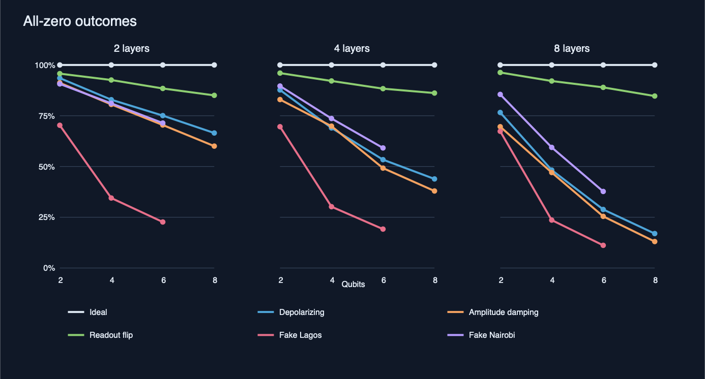

# Попередній експеримент: дзеркальні brickwall-схеми

**Дата:** 12 жовтня 2026 року. **Середовище:** Qiskit 2.5.2, Qiskit Aer 0.17.2 і Qiskit IBM Runtime 0.50.0; лише локальна симуляція. [Код запуску](../experiments/mirror_brickwall.py), [результат кожного запуску](mirror_runs.csv), [повна підсумкова таблиця](mirror_summary.csv).

## Метод

Для кожної схеми чергуються шари однокубітних операцій H або X та операції CX між сусідніми кубітами. Пари CX зсуваються між сусідніми шарами, утворюючи brickwall-візерунок. Після прямої частини виконується її точна обернена копія. Без шуму очікується лише бітовий рядок з усіх нулів.

Використано 2, 4, 6 і 8 кубітів; 2, 4 і 8 шарів у прямій частині; 5 відтворюваних варіантів схеми для кожного поєднання; 1024 вимірювання на варіант. Для кожної умови, розміру й глибини це 5120 вимірювань. Готові профілі семикубітних пристроїв перевірено лише для 2, 4 і 6 кубітів. Пряма й обернена частини розділені бар’єром, а компіляція виконана без оптимізації, щоб операції не скоротилися до вимірювання порожньої схеми.

Порівнюються шість умов:

| Умова | Параметри симуляції |
| --- | --- |
| Без шуму | Ідеальний симулятор. |
| Depolarizing | Імовірність помилки 0,005 після H/X і 0,03 після CX. |
| Amplitude damping | Параметр 0,01 після H/X і 0,03 для кожного кубіта після CX. |
| Readout flip | Помилка зчитування 0→1 та 1→0 з імовірністю 0,02. |
| Fake Lagos | Готовий профіль Qiskit з історичним знімком характеристик пристрою Lagos. |
| Fake Nairobi | Готовий профіль Qiskit з історичним знімком характеристик пристрою Nairobi. |

Параметри трьох моделей шуму задано для демонстрації. Профілі Fake Lagos і Fake Nairobi використовують збережені характеристики пристроїв через `AerSimulator.from_backend`; вони не відображають їхній поточний стан і не є запуском на реальному обладнанні. Компіляція під різні профілі також може змінювати набір фізичних операцій. [Документація IBM щодо fake backends](https://eu-de.quantum.cloud.ibm.com/docs/en/guides/local-simulators).

## Результати

### Візуалізація

Лінії Fake Lagos і Fake Nairobi закінчуються на 6 кубітах, бо профілі мають лише 7. Перебудувати файли на macOS можна командами `uv run experiments/plot_results.py` і `sips -s format png results/mirror_lines.svg --out results/image.png`.

Для прикладу нижче наведено схеми з 4 шарами у прямій частині. «Усі нулі» — частка вимірювань з результатом `00…0`. «Нулів у рядку» — середня кількість нулів серед усіх виміряних бітових рядків; максимум дорівнює кількості кубітів.

| Кубітів | Умова | Усі нулі | Нулів у рядку |
| ---: | --- | ---: | ---: |
| 2 | Без шуму | 100,00% | 2,000 |
| 2 | Depolarizing | 87,70% | 1,838 |
| 2 | Amplitude damping | 82,97% | 1,772 |
| 2 | Readout flip | 96,00% | 1,960 |
| 2 | Fake Lagos | 69,61% | 1,664 |
| 2 | Fake Nairobi | 89,65% | 1,890 |
| 4 | Без шуму | 100,00% | 4,000 |
| 4 | Depolarizing | 68,98% | 3,480 |
| 4 | Amplitude damping | 69,86% | 3,529 |
| 4 | Readout flip | 92,13% | 3,919 |
| 4 | Fake Lagos | 30,20% | 2,995 |
| 4 | Fake Nairobi | 73,63% | 3,622 |
| 6 | Без шуму | 100,00% | 6,000 |
| 6 | Depolarizing | 53,36% | 5,022 |
| 6 | Amplitude damping | 49,20% | 4,960 |
| 6 | Readout flip | 88,34% | 5,877 |
| 6 | Fake Lagos | 19,18% | 4,460 |
| 6 | Fake Nairobi | 59,14% | 5,306 |
| 8 | Без шуму | 100,00% | 8,000 |
| 8 | Depolarizing | 43,87% | 6,803 |
| 8 | Amplitude damping | 37,93% | 6,715 |
| 8 | Readout flip | 86,15% | 7,853 |

У цьому наборі умов частка результатів «усі нулі» зменшується зі збільшенням кількості кубітів. Повні результати для 2, 4 та 8 шарів є в `mirror_summary.csv`. Це описові результати симуляції, а не доказ ефективності методу виправлення похибок.

## Повторний запуск

У корені репозиторію виконайте `uv run experiments/mirror_brickwall.py`. Файл `uv.lock` фіксує версії залежностей. Скрипт перезаписує два CSV-файли в цій папці та перевіряє, що без шуму кожна дзеркальна схема повертає лише нулі.
